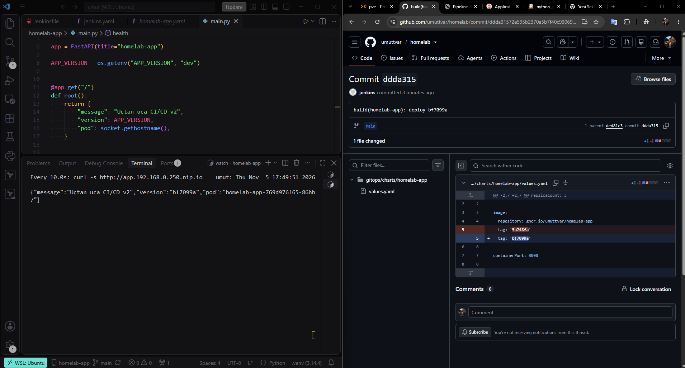
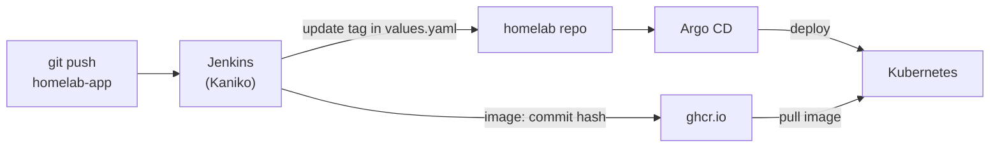
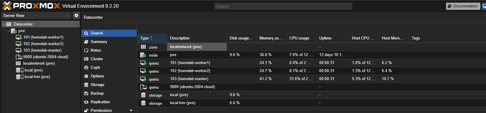
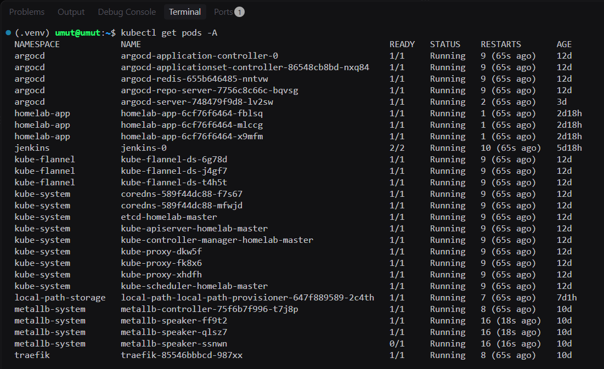
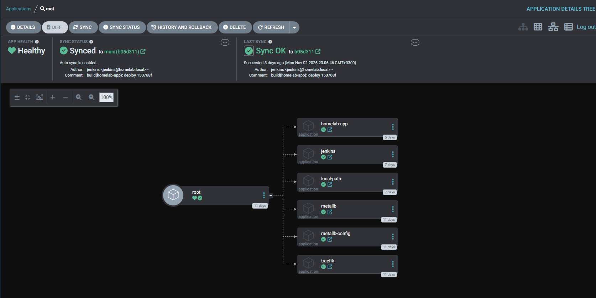
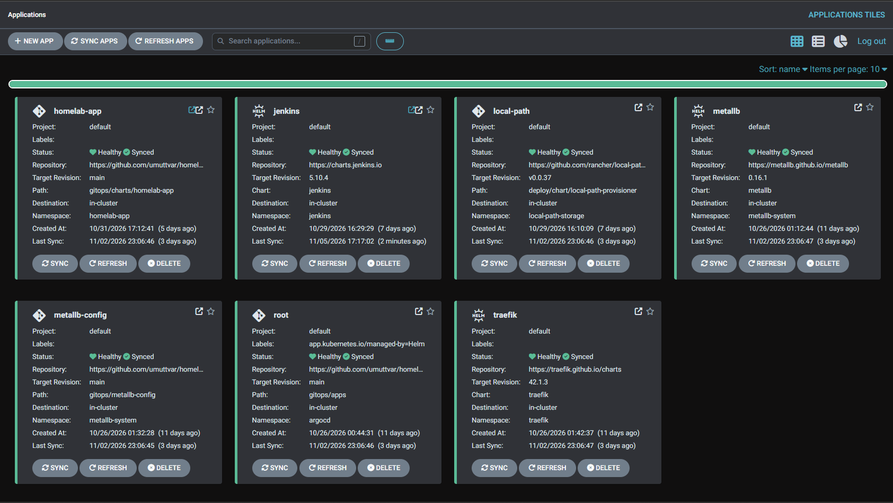
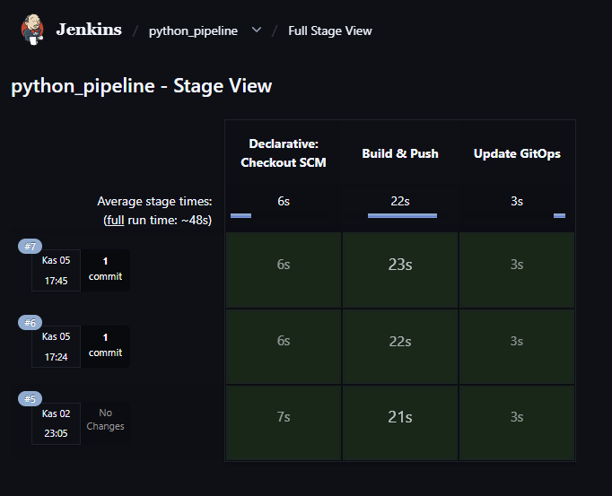

# homelab

My home Kubernetes platform, built **fully as code** on my own Proxmox server.

🇹🇷 [Türkçe README](README.tr.md) · 🐍 App repo: [umuttvar/homelab-app](https://github.com/umuttvar/homelab-app) · 🧪 First version: [umuttvar/homelab-k8s](https://github.com/umuttvar/homelab-k8s)

In my first homelab I set up most things by hand. In this version I wanted to rebuild everything with code, so I can delete it and build it again with the same result.



---

## How it works



1. I push a change to the app repo.
2. Jenkins sees the new commit, builds the image with Kaniko and pushes it to ghcr.io. The image tag is the short commit hash.
3. Jenkins changes the image tag in `values.yaml` in this repo and pushes the commit.
4. Argo CD sees the change in Git and deploys the new version.

From `git push` to a new image takes about **48 seconds**. Argo CD deploys it a few minutes later. I don't run any command by hand.

---

## What I built

| Layer | Tools | What it does |
|---|---|---|
| VMs | Proxmox, Terraform | Creates 3 Ubuntu VMs from a cloud-init template |
| Cluster | Ansible, kubeadm, containerd, Flannel | Prepares the VMs and builds a 3-node Kubernetes cluster |
| GitOps | Terraform (Helm provider), Argo CD | Installs Argo CD and a root app (App of Apps) |
| Platform | MetalLB, Traefik, local-path-provisioner | LoadBalancer IPs, Ingress and storage on bare metal |
| CI | Jenkins, Kaniko | Builds and pushes images inside Kubernetes, without Docker |
| App | Python (FastAPI), Docker, my own Helm chart | A small app with a `/health` endpoint |

## Repository structure

```
terraform/proxmox/    # 3 VMs
ansible/              # OS prep + kubeadm cluster
terraform/platform/   # Argo CD + root app
gitops/apps/          # Argo CD Applications (MetalLB, Traefik, Jenkins, app...)
gitops/metallb-config/
gitops/charts/homelab-app/   # my Helm chart
docs/images/
```

---

## Screenshots

| | |
|---|---|
|  |  |
|  |  |
|  | |

---

## Choices I made

- **local-path-provisioner for storage:** simple and enough for a homelab. The data stays on one node, so it is not highly available.
- **Kaniko for builds:** it builds images without a Docker daemon or special permissions. The original project is archived, so I pinned the last version (`v1.24.0-debug`).
- **Two GitHub tokens:** ghcr.io only accepts classic tokens, so that token has only `write:packages`. For writing to this repo I used a fine-grained token that can only change this one repo.
- **Poll SCM instead of a webhook:** Jenkins runs in my home network and GitHub cannot reach it, so Jenkins checks for new commits every 3 minutes.
- **Secrets are not in Git:** tokens are stored in Jenkins credentials and in local files with `chmod 600`.

## Problems I had

| Problem | Cause | Fix |
|---|---|---|
| Jenkins pod failed after every restart | The chart's init script uses `yes n \| cp -i` with `set -e`. When the plugin files already exist, `cp` returns an error. | `controller.initializeOnce: true`. When I add a plugin, I delete the marker file and restart the pod. |
| Argo CD did not install anything | `path` pointed to a file or the wrong folder | `path` must be the folder that has `Chart.yaml` (or the YAML files) |
| Jenkins `sh` steps failed in the Kaniko container | The normal Kaniko image has no shell | Use the `-debug` image |
| `git push` was rejected | Jenkins had already pushed commits to the same repo | `git pull --rebase`, never `--force` |
| QEMU guest agent did not start | The VM had no agent channel | `agent { enabled = true }` in Terraform and a reboot |

## Next steps

- [ ] Monitoring with Prometheus and Grafana
- [ ] A test stage in the pipeline
- [ ] Ingress for Argo CD
- [ ] Jenkins credentials and config as code (JCasC)
