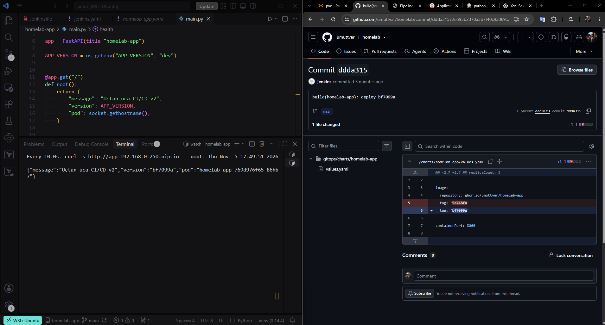
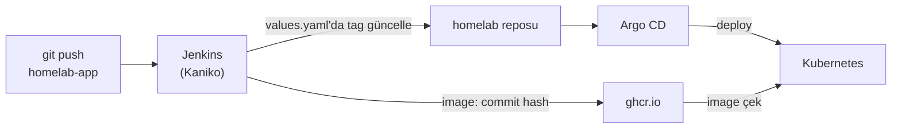
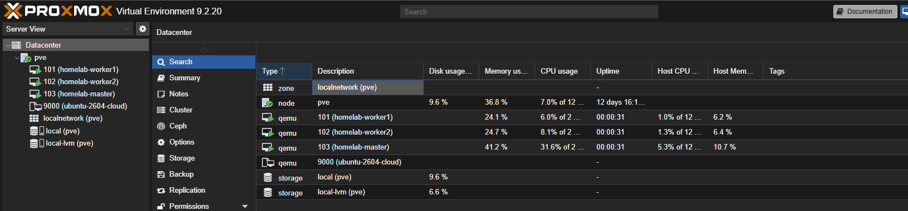
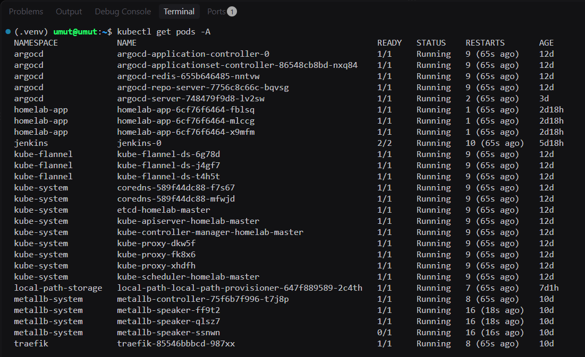
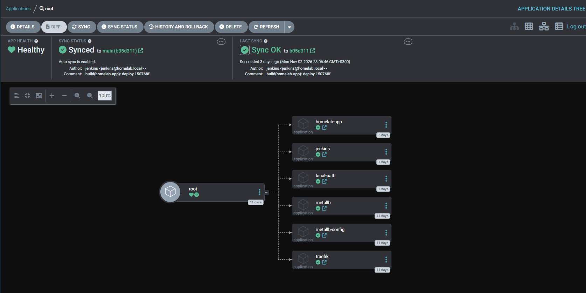
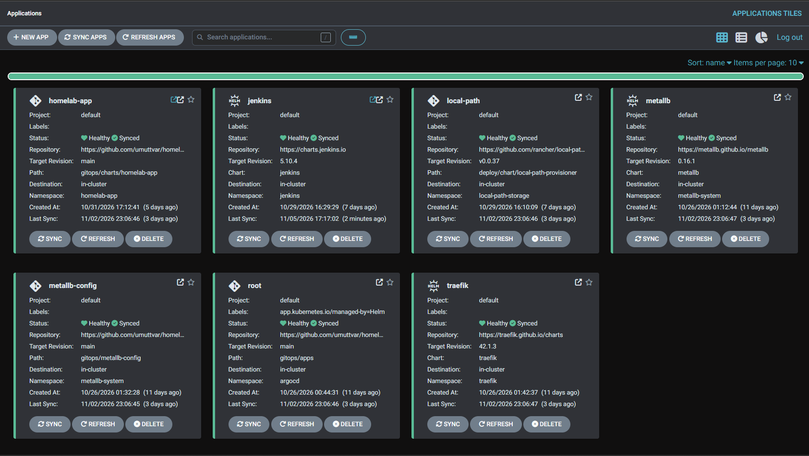
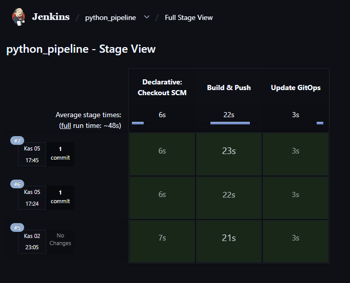

# homelab

Kendi Proxmox sunucumda, **tamamen kod olarak** kurduğum Kubernetes platformu.

🇬🇧 [English README](README.md) · 🐍 Uygulama reposu: [umuttvar/homelab-app](https://github.com/umuttvar/homelab-app) · 🧪 İlk sürüm: [umuttvar/homelab-k8s](https://github.com/umuttvar/homelab-k8s)

İlk homelab'imde çoğu şeyi elle kurmuştum. Bu sürümde her şeyi kodla yeniden kurmak istedim; böylece silip tekrar kurduğumda aynı sonucu alabiliyorum.



---

## Nasıl çalışıyor?



1. Uygulama reposuna bir değişiklik pushluyorum.
2. Jenkins yeni commit'i görüyor, Kaniko ile image'ı build edip ghcr.io'ya gönderiyor. Image tag'i, commit hash'inin kısa hali.
3. Jenkins bu repodaki `values.yaml`'da image tag'ini değiştirip commit'liyor.
4. Argo CD Git'teki değişikliği görüyor ve yeni sürümü deploy ediyor.

`git push`'tan yeni image'a kadar yaklaşık **48 saniye** sürüyor. Argo CD birkaç dakika içinde deploy ediyor. Elle hiçbir komut çalıştırmıyorum.

---

## Neler kurdum?

| Katman | Araçlar | Ne yapıyor |
|---|---|---|
| VM'ler | Proxmox, Terraform | Cloud-init şablonundan 3 Ubuntu VM oluşturuyor |
| Cluster | Ansible, kubeadm, containerd, Flannel | VM'leri hazırlayıp 3 node'lu bir Kubernetes cluster'ı kuruyor |
| GitOps | Terraform (Helm provider), Argo CD | Argo CD'yi ve root app'i (App of Apps) kuruyor |
| Platform | MetalLB, Traefik, local-path-provisioner | Bare metal'de LoadBalancer IP'leri, Ingress ve depolama |
| CI | Jenkins, Kaniko | Image'ları Docker olmadan, Kubernetes içinde build edip gönderiyor |
| Uygulama | Python (FastAPI), Docker, kendi Helm chart'ım | `/health` endpoint'i olan küçük bir uygulama |

## Repo yapısı

```
terraform/proxmox/    # 3 VM
ansible/              # İşletim sistemi hazırlığı + kubeadm cluster
terraform/platform/   # Argo CD + root app
gitops/apps/          # Argo CD Application'ları (MetalLB, Traefik, Jenkins, uygulama...)
gitops/metallb-config/
gitops/charts/homelab-app/   # kendi Helm chart'ım
docs/images/
```

---

## Ekran görüntüleri

| | |
|---|---|
|  |  |
|  |  |
|  | |

---

## Yaptığım tercihler

- **Depolama için local-path-provisioner:** Basit ve homelab için yeterli. Veri tek bir node'da duruyor, yani yüksek erişilebilirlik yok.
- **Build için Kaniko:** Docker daemon'ı ve özel yetki olmadan image build ediyor. Orijinal proje arşivlendiği için son sürümü (`v1.24.0-debug`) sabitledim.
- **İki GitHub token'ı:** ghcr.io sadece classic token kabul ediyor, o yüzden o token'da sadece `write:packages` yetkisi var. Bu repoya yazmak için ise sadece bu repoyu değiştirebilen fine-grained bir token kullandım.
- **Webhook yerine Poll SCM:** Jenkins ev ağımda çalışıyor ve GitHub ona ulaşamıyor. Bu yüzden Jenkins 3 dakikada bir yeni commit olup olmadığına bakıyor.
- **Secret'lar Git'te değil:** Token'lar Jenkins credentials'ta ve `chmod 600` ile korunan yerel dosyalarda duruyor.

## Karşılaştığım sorunlar

| Sorun | Sebep | Çözüm |
|---|---|---|
| Jenkins pod'u her yeniden başlatmada çöküyordu | Chart'ın init script'i `set -e` ile `yes n \| cp -i` kullanıyor. Plugin dosyaları zaten varsa `cp` hata döndürüyor. | `controller.initializeOnce: true`. Plugin eklediğimde işaret dosyasını silip pod'u yeniden başlatıyorum. |
| Argo CD hiçbir şey kurmuyordu | `path` bir dosyayı ya da yanlış klasörü gösteriyordu | `path`, `Chart.yaml`'ın (ya da YAML dosyalarının) bulunduğu klasör olmalı |
| Kaniko container'ında Jenkins `sh` adımları hata veriyordu | Normal Kaniko image'ında shell yok | `-debug` image'ını kullanmak |
| `git push` reddedildi | Jenkins aynı repoya benden önce commit atmıştı | `git pull --rebase`, asla `--force` değil |
| QEMU guest agent başlamıyordu | VM'de agent kanalı yoktu | Terraform'da `agent { enabled = true }` ve yeniden başlatma |

## Sonraki adımlar

- [ ] Prometheus ve Grafana ile izleme
- [ ] Pipeline'a test aşaması
- [ ] Argo CD için Ingress
- [ ] Jenkins credential'ları ve ayarlarını kod olarak yönetmek (JCasC)
